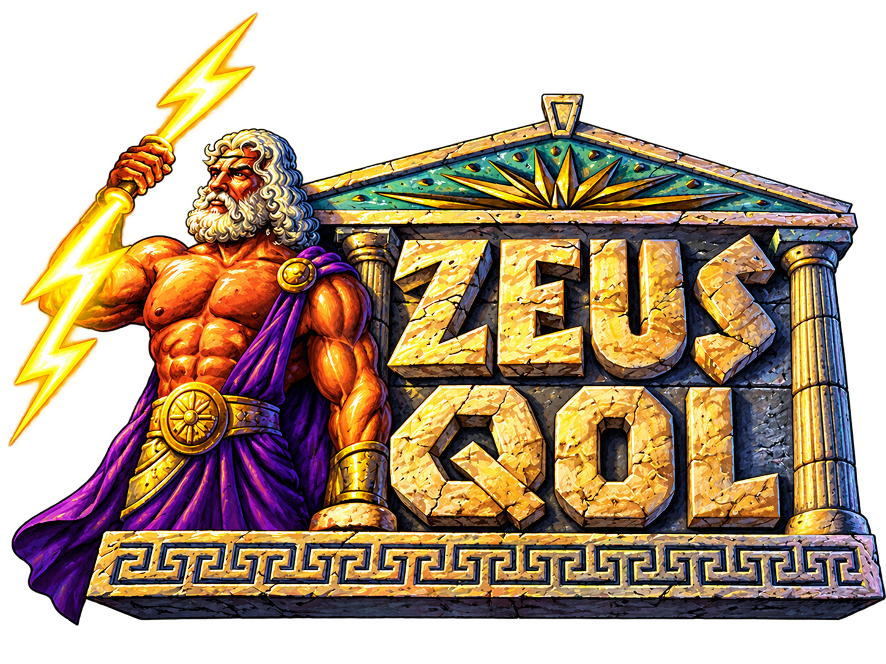
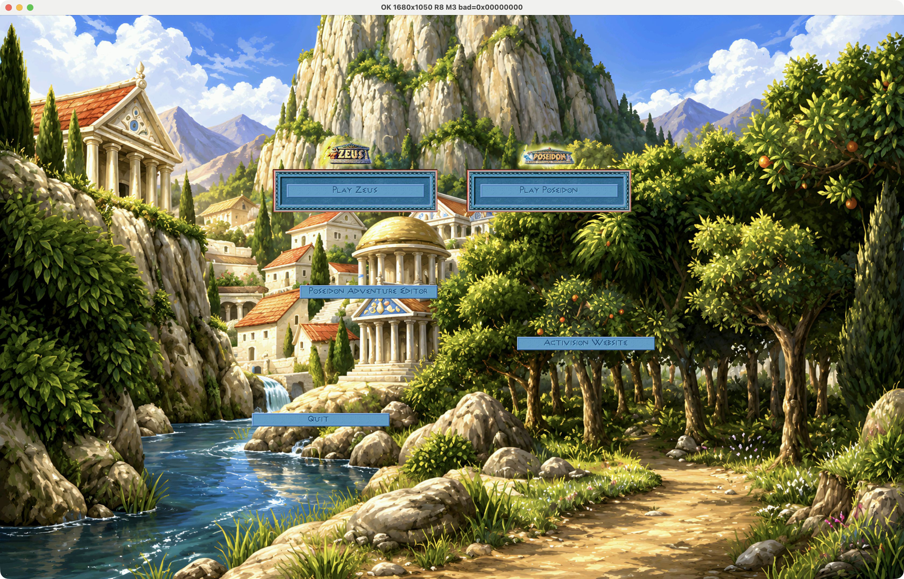
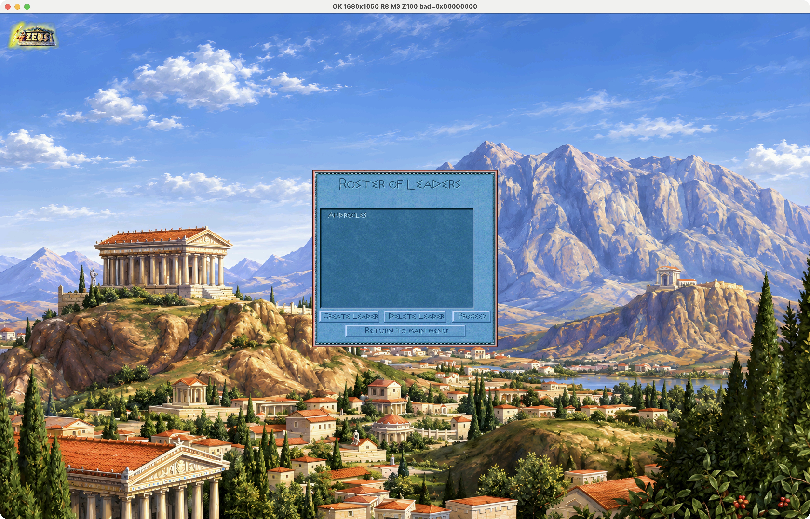
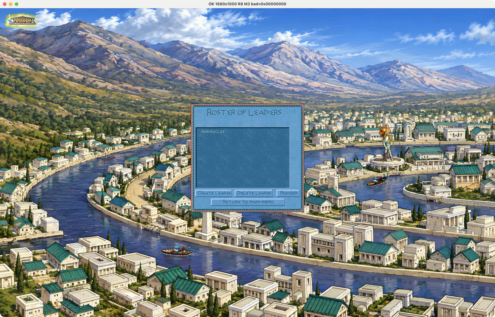
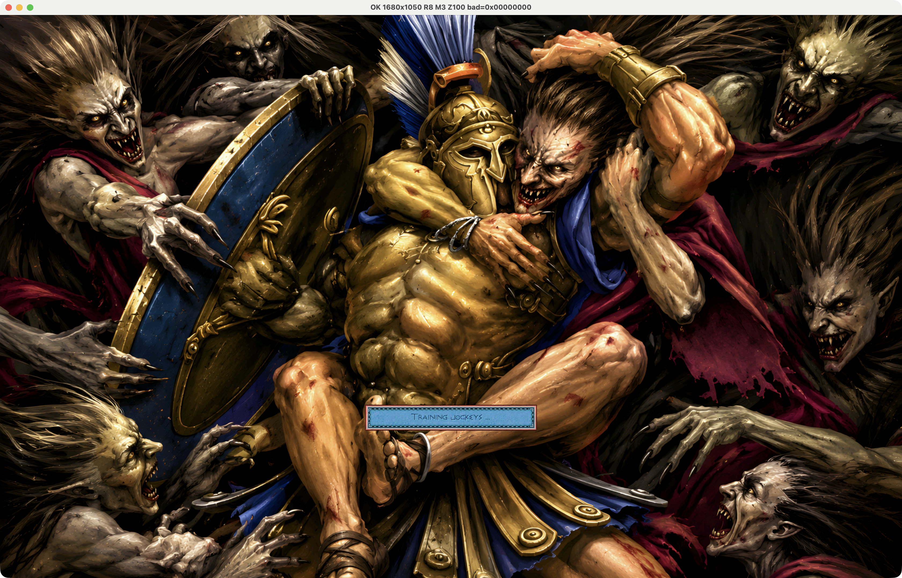
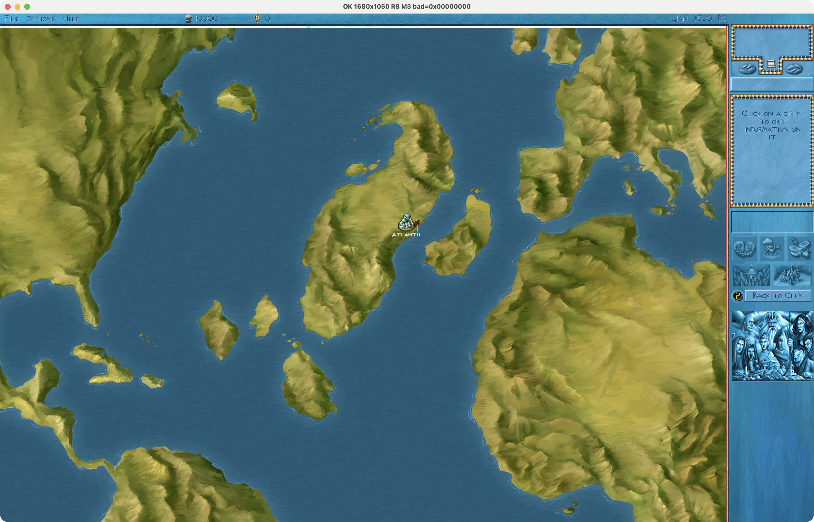
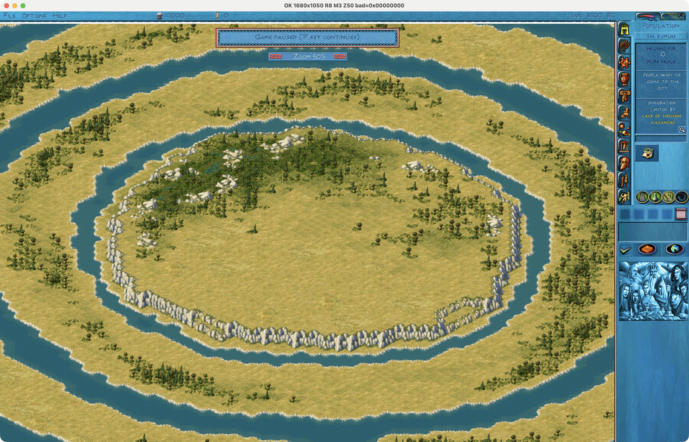
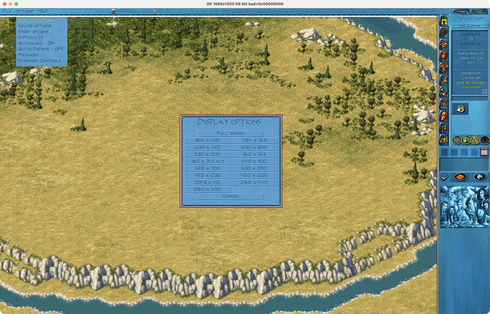
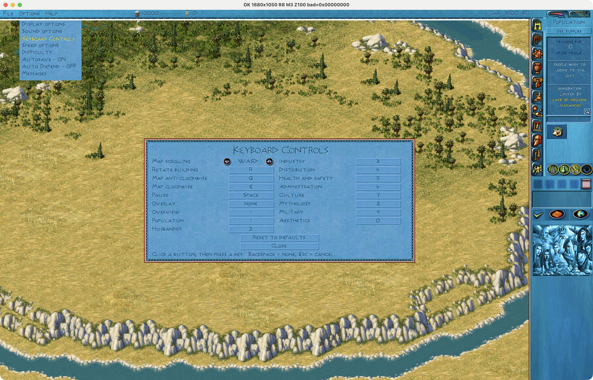

# Zeus QOL

A quality-of-life patch for *Zeus: Master of Olympus* with the *Poseidon* expansion (GOG version). It adds widescreen resolutions up to 2560x1600, higher resolution menu and map art, city zoom, remappable keys and a city image export.

You need your own copy of the game. This patch contains no game files; it changes your installed copy and keeps a backup of everything it touches.

## Features

- **Widescreen.** 14 resolutions from 1024x768 to 2560x1600, switchable in game under Options > Display options (F7 for the next one, Shift+F7 for the previous one, F6 for 800x600). The choice is remembered.
- **Interface.** Sidebars and top bar are stretched to the new screen height and width.
- **World maps.** One high resolution picture per map, scaled to fill the map screen at any resolution. Cities, routes and click areas follow the scale.
- **Menu and load screens.** Full-screen pictures for the main menus, mission introduction, victory and defeat screens and all load screens, scaled to cover the screen without bars.
- **Launch video.** A 3852x2070 version of the intro, scaled to the game window. The original videos stay in place and are used if the file is removed.
- **City zoom.** Mouse wheel over the map, 50% to 200%. The window title shows the current level.
- **Keyboard Controls.** Options > Keyboard Controls lets you remap map scrolling (WASD or arrow keys), building and map rotation, pause, overlay, overview and the ten control panel tabs.
- **Export City Image.** File > Export City Image saves the whole scrollable city as a PNG on your Desktop. The game asks for the file name.
- The widescreen animation fix for gods and urchin collectors.

## Screenshots

*Main menu with the full-screen art.*

*Zeus roster screen.*

*Poseidon roster screen.*

*A load screen.*

*World map scaled to fill the map screen.*

*City zoomed out to 50%. The notice and the window title show the zoom level.*

*Options > Display options lists every resolution.*

*Options > Keyboard Controls.*

## Requirements

- Zeus + Poseidon from GOG, with `Zeus.exe` version 2.1.4.0. The patcher checks this and refuses other versions (Steam and disc versions are not supported).
- About 1.4 GB of free disk space.
- Windows. The patcher is a 32-bit program and runs on 32-bit and 64-bit Windows. It also runs under Wine and CrossOver.

## Installation

1. Download the latest ZIP from the [Releases](https://github.com/andrehamon/zeus-qol/releases) page and unzip it anywhere. Keep `ZeusPatcher.exe` next to its `payload` folder.
2. Close the game and run `ZeusPatcher.exe`.
3. Check that the game folder is the one that contains `Zeus.exe` (use **Browse...** if it is not) and click **Install**.
4. Start the game as usual.

The patcher backs up your original files to a `ZeusPatch_backup` folder inside the game folder, replaces them, and checks every file when it is done. If anything fails it puts the originals back. If Windows reports "access denied", run `ZeusPatcher.exe` as administrator.

## Uninstall or reinstall

Run `ZeusPatcher.exe` again. When it finds the patch already installed it offers two options:

- **Remove patch** puts the backed-up original files back and deletes the files the patch added.
- **Reinstall** puts the backed-up files back, then patches again.

Saved games, `Zeus.res` (resolution) and `Zeus.keys` (key bindings) are not touched. Files of your own that the patch would overwrite, such as your own `Zeus_Intro_HD.bik`, are backed up too and restored on removal.

## What changes in the game folder

| File | Change |
|---|---|
| `Zeus.exe` | patched |
| `Data\Zeus_Interface.*`, `Data\Poseidon_Loaded.*`, `Data\Zeus_Unloaded.sg3`, `Data\map_panels.555` | replaced (originals in `ZeusPatch_backup`) |
| `Data\Images\*.png`, `Data\Maps\*.png` | added |
| `Binks\Zeus_Intro_HD.bik` | added |

Every PNG in `Data\Images` is one picture that the game scales to cover the screen. You can replace one with your own 8-bit RGB or RGBA, non-interlaced PNG. A missing or unreadable file makes the game use its own picture for that screen.

## Known limitations

- Developed and tested under Wine (CrossOver) on macOS. It has not been tested on real Windows yet.
- At 1280x1024 the world map is wider than the screen and is cut off at one side.
- On a Mac under Wine, Export City Image saves to the macOS Desktop.

## Support

If you like the patch, you can support its development:

